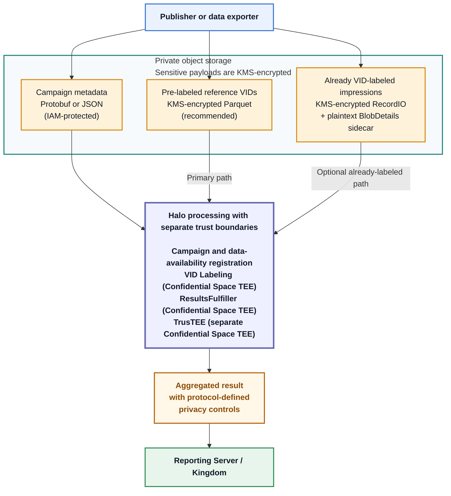
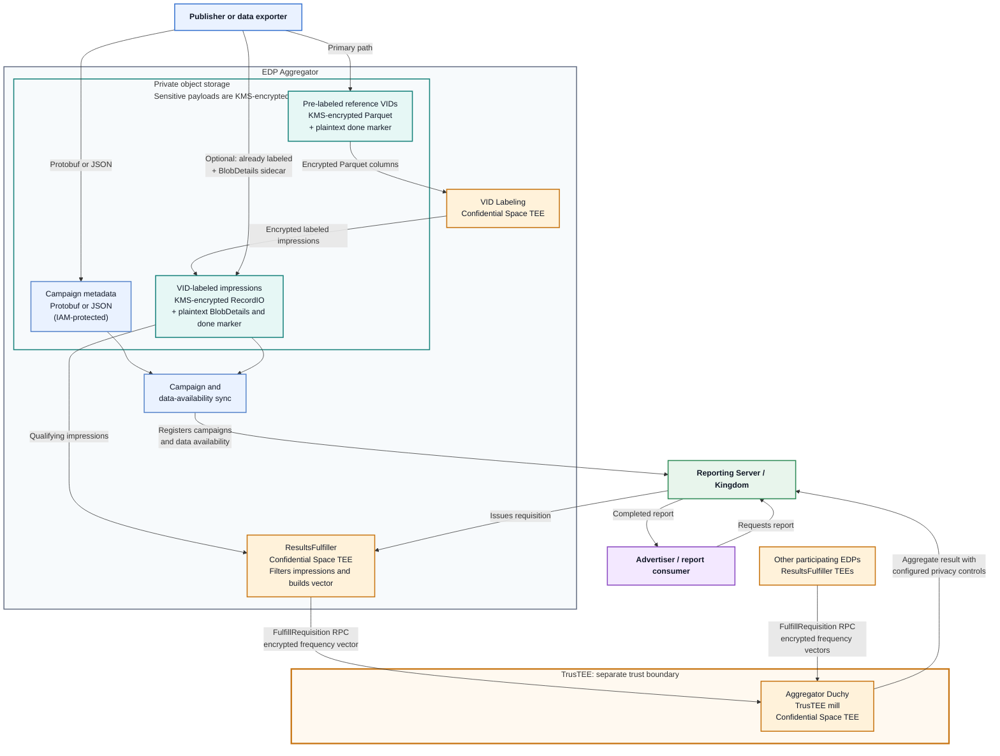

# How data moves through the EDP Aggregator

This guide follows impression data from a partner's export through the EDP
Aggregator (EDPA) and, when enabled, TrusTEE to a Halo measurement result. It is
for technical and security teams that want to understand the system before
building or approving an integration.

For the files to produce and the onboarding steps to complete, start with
[common EDP onboarding](README.md), then follow the
[Parquet onboarding guide](parquet-onboarding.md). This guide uses that
recommended path: encrypted Parquet input and EDPA-managed Virtual Person ID
(VID) labeling. It shows TrusTEE fulfillment where that capability is enabled.

A publisher may produce the export itself, or an advertiser or another data
aggregator may prepare it on the publisher's behalf. Halo identifies the data as
belonging to a registered Event Data Provider (EDP), regardless of which system
creates the files.

## Contents

1. [The complete flow](#1-the-complete-flow)
2. [The two input feeds](#2-the-two-input-feeds)
3. [What happens after upload](#3-what-happens-after-upload)
4. [Where the data can be decrypted](#4-where-the-data-can-be-decrypted)
5. [What attestation and key policy enforce](#5-what-attestation-and-key-policy-enforce)
6. [Alternative: upload already VID-labeled data](#6-alternative-upload-already-vid-labeled-data)
7. [Related documentation](#7-related-documentation)

## 1. The complete flow

Campaign information and impressions are separate feeds. They meet when an
impression's entity key matches the entity key of a campaign registered in
Halo.

### Simplified Halo flow

This view intentionally hides queues, markers, and intermediate files. “Halo
processing” is not one TEE: VID Labeling, ResultsFulfiller, and TrusTEE are
separately attested workloads, and TrusTEE has a separate trust boundary.

The primary path is encrypted Parquet. The already-labeled path is included only
to show where it joins the flow; its format is documented separately.

### Detailed EDP Aggregator and TrusTEE flow

The detailed view follows the source architecture from top to bottom.
Pre-labeled reference VID Parquet passes through VID Labeling, while
already-labeled RecordIO joins at the VID-labeled impression store. Both paths
converge before ResultsFulfiller processes a requisition.

Each trusted workload is shown in its own Confidential Space TEE. Sensitive data
passes from ResultsFulfiller to the aggregator Duchy as an encrypted contribution
over the `FulfillRequisition` RPC. There is no frequency-vector storage bucket in
this handoff, and the two components do not share one TEE boundary.

Both diagrams use KMS labels only for sensitive payloads. Campaign metadata,
`BlobDetails`, and `done` markers remain readable to services authorized to
access the private storage location. Internal queues, retries, and
model-specific VID-labeling stages are omitted because they do not change the
export contract.

## 2. The two input feeds

| Feed | What the exporter sends | What connects it to the other feed |
| --- | --- | --- |
| Campaign information | `EventGroup` records describing campaigns and their data intervals | An `entity_key`, such as a campaign ID |
| Daily impressions | PME-encrypted Parquet with one row per impression, followed by a `done` marker | At least one matching entity type and ID; IDs come from the configured Parquet columns |

Campaign information may come from a different source system than the daily
impression export. It does not need to be uploaded every day, but it must be
published when a campaign is added, changed, or deleted.

The impression feed is a file boundary. The exporting system does not need a
live database connector, a Halo SDK, or an API call for each measurement. It
must produce the agreed impression-level fields, apply Parquet Modular
Encryption (PME), upload every file for the date, and create the pre-labeled
reference VID upload `done` marker last.

See the onboarding guide for the authoritative
[Parquet contract](parquet-onboarding.md#1-agree-on-the-parquet-contract),
[campaign format](README.md#5-publish-campaign-information), and
[daily upload layout](parquet-onboarding.md#2-upload-daily-impressions). The
market operator provides the market-specific event schema and VID-model inputs;
they are not a universal EDPA schema.

## 3. What happens after upload

### 1. Halo registers campaign information

The EventGroup sync service reads the campaign file and creates, updates, or
deletes the corresponding `EventGroup` resources in Halo. These records tell
Halo which advertiser owns the campaign, when data are available, and which
entity key identifies its impressions.

### 2. The pre-labeled reference VID upload marker closes the daily export

When the pre-labeled reference VID upload `done` marker arrives, EDPA lists the
Parquet objects in that date's directory, reads their plaintext footers, records
their exact object versions, and determines which VID model lines apply. The
marker is a completion signal; it contains no impression data.

A new generation of `done` can create another upload revision. Follow the
[pre-labeled reference VID backfill and correction guide](reference-vid-impression-upload-guide.md):
additive backfills may add new object versions, while correcting or removing
previously processed data requires operator-managed eviction.

### 3. EDPA assigns VIDs in trusted hardware

EDPA dispatches the registered files to the VID-labeling workloads.
Inside Google Confidential Space, the workload presents an attestation to the
data owner's key policy, decrypts the protected Parquet columns, and applies the
configured VID model.

The workload writes:

* encrypted RecordIO containing `LabeledImpression` messages;
* a `BlobDetails` metadata record for each encrypted blob; and
* a labeled-output `done` marker after the output is complete.

The labeled records contain the event data needed for measurement, the assigned
VID, and the entity keys used to associate impressions with campaigns. The
encrypted output can be stored and processed later without keeping the input
columns decrypted.

### 4. Halo records which dates are available

The labeled-output marker starts a separate synchronization step. EDPA reads the
`BlobDetails` records, stores the impression metadata, and publishes the
available time intervals for each model line to Halo.

This tells Halo which dates and model lines have labeled data ready for
measurement.

### 5. Halo sends a measurement requisition

When a report needs this EDP's data, Halo creates a requisition. EDPA retrieves
the requisition, groups compatible work, and dispatches it to ResultsFulfiller.
The data exporter does not approve or process each requisition.

### 6. ResultsFulfiller builds the EDP's contribution

ResultsFulfiller runs in its own Confidential Space TEE. It decrypts the
requisition specification and the relevant labeled-impression blobs, then:

1. selects data in the requested time interval;
2. matches the requested campaigns using entity keys;
3. applies the requested event filters; and
4. counts the qualifying impressions by VID in a frequency vector.

The vector contains counts at positions defined by the configured population.
It contains neither impression records nor explicit VID values.

For a non-empty TrusTEE contribution, ResultsFulfiller encrypts that vector and
streams it to the aggregator Duchy over the `FulfillRequisition` RPC.

### 7. TrusTEE computes the measurement result

TrusTEE is a separate Confidential Space workload. It decrypts the submitted
frequency-vector contributions, combines them, and computes the protocol result.
The selected protocol version and deployment configuration determine exactly
where minimum-threshold and differential-privacy operations occur; some controls
may be applied before the handoff and others inside TrusTEE.

TrusTEE sends the result through Halo for reporting. The result contains the
requested aggregate measurement, not impression-level records.

## 4. Where the data can be decrypted

Cloud-storage access and decryption access are separate. An operator service may
need to list an object or read its metadata without being able to decrypt its
impression payload.

| Artifact | Created by | Protection and visibility | Workload that can decrypt the sensitive payload |
| --- | --- | --- | --- |
| Campaign metadata | Data exporter | Kept in private operator-provided storage; it is not protected by the impression KEK | No impression-payload decryption is involved |
| Pre-labeled reference VID Parquet | Data exporter | Configured data columns are protected with PME under the data owner's KMS key; the schema, footer, `event_date`, object name, and object size are not protected by PME | Enabled VID-labeling TEE workloads |
| Pre-labeled reference VID upload `done` marker | Data exporter | Plaintext completion signal containing no impression records | None |
| VID-labeled RecordIO | VID-labeling TEE or data exporter | Payload is envelope-encrypted under the data owner's KMS key | ResultsFulfiller TEE |
| `BlobDetails` | VID-labeling TEE or data exporter | Metadata sidecar containing the blob URI, interval, entity keys, model line, and encrypted data-encryption key; it does not contain impression records | None; the wrapped key is used by an authorized KMS client |
| TrusTEE contribution | ResultsFulfiller TEE | A non-empty frequency vector is envelope-encrypted for TrusTEE | TrusTEE TEE |
| Measurement result | TrusTEE and Halo | Aggregate protocol result delivered through Halo | The authorized result recipient under the selected protocol |

The operator's private bucket, IAM policy, and transport security protect all of
these objects from unauthorized access. The data owner's KMS policy adds a
separate control over the sensitive impression payloads.

## 5. What attestation and key policy enforce

The data owner configures its cloud key manager once during onboarding. It does
not approve individual files, jobs, or measurement requests.

Before a trusted workload can use the key, its Confidential Space environment
presents hardware-backed attestation claims. A production policy should require
every claim supported by the selected attestation path:

* a genuine, non-debug Confidential Space environment;
* an image signed by the approved Halo signing key;
* an approved operator project; and
* the expected runtime service account or workload identity, when that claim is
  available through the selected cloud's attestation path.

The policy should allow only the workload classes enabled for the integration:

* VidLabeler and any enabled VID-model preparation stages;
* ResultsFulfiller; and
* TrusTEE.

These are separate workload classes even when they trust the same KMS key. The
operator supplies the exact projects and identities used in a market.

An image signature identifies an approved publisher of builds. It does not pin
one exact build or prove that a particular source-code change was reviewed or
merged. Project and workload-identity conditions therefore remain important.

Revoking or narrowing the KMS policy prevents future decryptions even if an
identity still has access to the storage bucket.

## 6. Alternative: upload already VID-labeled data

An EDP that assigns VIDs before upload can skip the pre-labeled reference VID
Parquet and EDPA VID-labeling stages. It uploads encrypted RecordIO, one
`BlobDetails` sidecar per blob, and a labeled-output `done` marker. From
data-availability synchronization onward, it joins the same flow shown above.

See [Onboard with already VID-labeled impressions](vid-labeled-onboarding.md)
for that format and upload procedure. The alternative path is not a native
Parquet upload and should not use the pre-labeled reference VID upload directory
layout.

## 7. Related documentation

| Document | Use it for |
| --- | --- |
| [Common EDP onboarding](README.md) | Registration, KMS, workload trust, storage access, and campaign publication shared by both paths |
| [Parquet onboarding](parquet-onboarding.md) | The recommended pre-labeled reference VID format and recurring upload procedure |
| [Already VID-labeled onboarding](vid-labeled-onboarding.md) | The alternative encrypted RecordIO and `BlobDetails` contract |
| [Google Cloud KMS onboarding](README.md#google-cloud-kms) | Google Cloud key and attestation policy setup |
| [AWS KMS onboarding](README.md#aws-kms) | AWS key and Confidential Space federation setup |
| [EDPA deployment guide](deployment-guide.md) | Operator-owned services and infrastructure |
| [`EventGroup` schema](../../src/main/proto/wfa/measurement/edpaggregator/eventgroups/v1alpha/event_group.proto) | Authoritative campaign metadata fields |
| [`LabeledImpression` schema](../../src/main/proto/wfa/measurement/edpaggregator/v1alpha/labeled_impression.proto) | Authoritative labeled-record fields |
| [`BlobDetails` schema](../../src/main/proto/wfa/measurement/edpaggregator/v1alpha/blob_details.proto) | Authoritative labeled-blob metadata fields |
