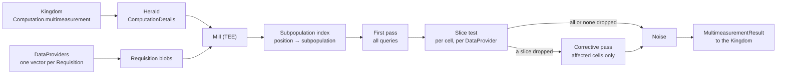

# TrusTEE v2 Mill Evaluation

This document describes how the TrusTEE v2 mill evaluates a multimeasurement:
the inputs it reads, how it maps frequency vector positions to population
attributes, the pass that evaluates every query, the corrective pass that
small-cell suppression may require, and how the result reaches the Kingdom.

## Overview

A multimeasurement fans out into one `Requisition` per base vector. Each
`DataProvider` fulfills its requisitions with a frequency vector over the
measurement's VID sampling interval. Once every requisition is fulfilled, the
aggregator Duchy runs the mill inside the attested TEE image. The mill reads the
N base vectors, evaluates every `Query` of the computation over them, applies
noise and small-cell suppression, and returns one `MultimeasurementResult` with
a cell per query per grouping combination.



## Inputs

The Herald copies what the mill needs from the system API `Computation` into
`TrusTeeV2.ComputationDetails`:

*   `queries`: the `Query` messages to evaluate.
*   `population_spec`: the `PopulationSpec` of the measurement's model line, as
    subpopulations of VID ranges, each with packed event template attributes.
*   `event_descriptor`: the event message type those attributes are written
    against, so that the Duchy needs no event template configuration of its
    own.
*   The VID sampling interval of the `MeasurementSpec`, which every base vector
    shares. This field is not yet in `ComputationDetails`.

Each fulfilled requisition carries a `vector_index`. Queries address base
vectors by that index, and the indexes of a computation's requisitions cover
`0` to `N - 1` exactly once.

## Frequency vector layout

A `DataProvider` builds its vector with `FrequencyVectorBuilder`. The global
index of a VID is the rank of its salted FarmHash fingerprint among all VIDs of
the `PopulationSpec`, with ties broken by VID (`InMemoryVidIndexMap`). For a
population of size `P` and sampling interval `[start, start + width)`, the
vector covers global indexes from `floor(P * start)` up to
`floor(P * (start + width)) - 1`, wrapping past `P - 1` to `0`. Position `p`
therefore holds global index `(floor(P * start) + p) mod P`.

Positions are not VIDs, so the mill cannot apply attribute filters or groupings
without the same rank order.

## Subpopulation index

The mill rebuilds the rank order from the `PopulationSpec` inside the TEE:

1.  Hash every VID with the shared salted hash (`VidHashing`), the same function
    `VidIndexMap` uses.
2.  Sort the VIDs by hash, then VID, over primitive arrays.
3.  Replace each sorted VID with the index of the subpopulation whose VID range
    holds it, giving a table from global index to subpopulation.

The interval bounds are computed in single precision exactly as
`FrequencyVectorBuilder` computes them, so that the mill's positions line up
with the `DataProviders`' vectors.

Separately, the mill resolves each subpopulation's attributes. It parses each
packed event template against `event_descriptor` and keeps the population
fields that are enum-valued and set, keyed by `<template name>.<field name>`,
for example `person.age_group` → `YEARS_18_TO_34`.

Building the table costs O(P log P) time. Peak memory is about 12 bytes per VID
while sorting, and the table keeps 4 bytes per VID.

## Query evaluation

Each `Query` reads as `SELECT reach, frequency, impressions FROM summands WHERE
vid_filter GROUP BY grouping_paths`.

### Compilation

Before reading any vector data, the mill compiles each query:

*   `summands` and every reach clause become arrays of vector indexes.
*   The `vid_filter.attributes` map becomes a pass or fail flag per
    subpopulation.
*   `grouping_paths` become a group id per subpopulation, one per distinct
    combination of attribute values. A path that a subpopulation does not set
    groups as unset.
*   Each group gets an accumulator with a frequency histogram of
    `max_frequency` bins, an impression total, and a reach count per
    `DataProvider`.

Attribute filters and grouping therefore cost one table lookup per position,
not per-VID attribute resolution.

### First pass

The first pass reads the N vectors as aligned chunks covering the same positions
in every vector, and applies every query at each position:

```
for each position p:
  s = subpopulation[p]
  for each query q:
    skip if q's attribute filter fails for s
    skip if q has reach clauses and none holds at p
    f = sum of counts at p over q's summands
    skip if f == 0
    acc = q's accumulator for the group of s
    acc.histogram[min(f, max_frequency) - 1] += 1
    acc.impressions += f
    for each DataProvider with a summand count > 0 at p:
      acc.slice_reach[DataProvider] += 1
```

A reach clause holds when the VID's count is greater than zero in at least one
vector of every reached set and zero in every vector of the unreached set. A VID
passes the filter when any clause holds.

Time is linear in the number of positions times the summands and clause sizes
of all queries. Memory is the chunk of each vector in flight, the accumulators,
and the subpopulation table, so the vectors never need to be held whole.

The result of evaluation is one unnoised cell per query per group that some VID
reached, with reach as the sum of the histogram.

## Suppression and the corrective pass

The attested image fixes the noise mechanism and the small-cell suppression
thresholds, so neither travels with the computation.

A cell's slice for a `DataProvider` is the VIDs in the cell that the
`DataProvider`'s summand vectors reached, counted once per VID. After the first
pass, each slice of each cell takes the noised minimum-reach test:

*   If every slice passes, the cell is emitted from the histogram it already
    holds.
*   If no slice passes, the cell is dropped.
*   If some slices fail, the cell is rebuilt in a corrective pass that sums only
    the surviving `DataProviders`' summands. The first-pass histogram cannot be
    corrected in place, because a VID's frequency is a sum across slices that
    the histogram does not separate.

The mill evaluates at most two passes. A slice's test reads only that slice's
reach, so dropping one slice cannot change another's verdict, and the survivors
are final after the first pass. The corrective pass walks the vectors again but
evaluates only the cells that lost a slice. Reports with many thin cells, deep
breakdowns or short windows drop slices most often and come closest to two full
passes.

A `DataProvider` that reports an impression count over the population can be
dropped before the first pass. The count bounds that `DataProvider`'s reach in
every cell, so a count that cannot clear the threshold removes its slice from
every cell before any histogram is allocated. A count the `DataProvider` noised
is compared to the threshold directly. An exact count is pruned only when it
falls short of the threshold by more than the noise truncation bound, so that
the prune fires only where the noised test would fail anyway.

## Noise

Each emitted cell is noised deterministically, so that rerunning the same
computation returns the same figures. This step also scales impressions to any
reported impression count and computes each cell's variance.

## Result

The mill packs the cells into a `MultimeasurementResult`, echoing each query's
`id`, and sets it on the computation as an unsigned, unencrypted `result`. A
multimeasurement `Result` has no aggregator certificate. The Kingdom then
completes the `Measurement`.

## Alternatives considered

*   **Load a precomputed VID index map.** `DataProviders` already build one per
    model line. This avoids the rebuild cost, but adds an input path into the
    Duchy and a trust point, since the TEE would have to verify that the map
    matches the `PopulationSpec`. The subpopulation index sits behind an
    interface, so this remains possible if the rebuild cost becomes a problem.
*   **No attribute filters or groupings.** This removes the need for the rank
    order, but drops the demographic breakdowns that multimeasurement exists to
    provide.

## Future optimizations

*   Compute one "reached" bitmask per position over the N vectors, so that
    every reach clause becomes two mask tests instead of reading counts per
    query.
*   Split chunks across threads with per-thread accumulators merged at the end.
    The accumulators hold integer sums, so the result is unchanged.

## Implementation plan

1.  The evaluation library: query evaluation, subpopulation attributes, and the
    subpopulation index, with the shared VID hash.
2.  Suppression with the corrective pass, and noise, over the evaluated cells.
3.  The mill: read the requisition blobs in chunks, run 1 and 2, and set the
    result. This adds the VID sampling interval to `ComputationDetails`.
